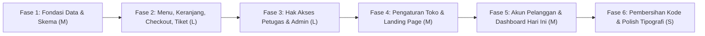

# AUDIT KELENGKAPAN HALAMAN, API, DAN KODE SISTEM
**Cravely Bakery & Patisserie**
*Tanggal Audit: 23 November 2026*

---

## 1. Tabel Audit Rute Halaman (Frontend Pages)

| Route | Siapa yang Membuka | Sumber Data | Status | Temuan Utama | Perlu Apa |
| :--- | :--- | :--- | :--- | :--- | :--- |
| `/` (`app/page.js`) | Publik (Semua Pengunjung) | Sebagian Tertulis di Kode (Dummy) & Asset Lokal | **SEBAGIAN** | Cerita dapur, alamat ("Jl. Melati Manis No. 18"), jam operasional ("08.00–20.00"), dan 4 Menu Populer (`POPULAR_CAKES`) tertulis statis di kode komponen. Formulir reservasi (`CravelyEditorialSections.tsx`) hanya memunculkan notifikasi visual tanpa mengirim data ke database atau WhatsApp. Tautan navbar keranjang mengarah ke `/kasir` (bukan `/keranjang` atau `/checkout`). | Hubungkan informasi toko dan jam dengan `pengaturan_toko`. Tampilkan Menu Populer dari produk bertanda `unggulan = true`. Ubah form reservasi menjadi pembuka tautan WhatsApp resmi dengan pesan otomatis. Hubungkan badge keranjang ke `/keranjang`. |
| `/menu` (`app/menu/page.js`) | Publik / Pelanggan | Campuran Database (`/api/produk`) & Fallback Dummy (`MENU_ITEMS`) | **SEBAGIAN** | Produk aktif diambil dari `/api/produk`, namun bila kolom belum lengkap (porsi, komposisi, badge, rating, terjual) sistem melakukan fallback ke array statis `MENU_ITEMS`. Rating "4.9" masih tampil di UI kartu. Tombol "Tambah ke Keranjang" memanggil `/api/keranjang` (jenis 'Siap'), tetapi jika 401 redirect ke `/masuk?redirect=/menu` (seharusnya parameter `ke`). Query param `?id=` yang dikirim dari Home tidak dibaca. | Perbarui skema tabel `produk` (tambah kolom porsi, komposisi, label_teks, unggulan, kategori). Hapus tampilan rating dan angka terjual palsu dari UI kartu produk. Perbaiki redirect auth ke `/masuk?ke=/menu`. Tangani scroll otomatis bila terdapat parameter `?id=`. |
| `/toko` (`app/toko/page.js`) | Publik | Tertulis di Kode / Asset 3D & Ilustrasi | **TERHUBUNG** | Menampilkan ruang toko 3D (`CafeScene`), etalase close-up (`EtalaseShowcaseView`), dan cerita butik. Data teks cerita bersifat editorial estetis. Tombol "Pesan Custom" mengarah ke `/pesan`, "Katalog" ke `/menu`, dan "Meja Kasir" ke `/kasir`. | Sesuaikan tombol aksi kasir agar mengarah ke `/keranjang` / `/checkout`, bukan mock pos `/kasir`. |
| `/pesan` (`app/pesan/page.js`) | Publik / Pelanggan | Database (`/api/opsi`, `/api/pengaturan`, `/api/ketersediaan`) & Client Canvas 3D | **TERHUBUNG** | Merupakan halaman studio 3D lama (milik rekan kerja). Terhubung ke database untuk opsi bahan, zona ongkir lama, dan tanggal tutup. Form pemesanan langsung mem-POST ke `/api/pesanan` (single-item custom cake order). Berdasarkan aturan kerja, file ini **read-only dan tidak boleh diubah**. | Pertahankan dukungan endpoint backend `/api/pesanan` dan tabel `zona_ongkir` agar studio mandiri ini tetap berjalan tanpa merusak kode rekan kerja. |
| `/checkout` (`app/checkout/page.js` $\rightarrow$ `CheckoutView.js`) | Pelanggan Login | Database (`/api/keranjang`, `/api/pengaturan`, `/api/ketersediaan`) | **SEBAGIAN** | Form terhubung ke `/api/checkout` dan `/api/keranjang`. Namun perhitungan DP pada UI checkout saat ini menghitung DP dari subtotal keseluruhan (bukan eksklusif kue Custom). Selain itu metode pengiriman masih mengandalkan pilihan `id_zona` dari tabel `zona_ongkir`, bukan rumus tarif per km berbasis radius. | Sesuaikan UI ringkasan harga: DP hanya diambil dari subtotal kue custom, sedangkan katalog + ongkir dibayar 100%. Integrasikan perhitungan ongkir radius jarak (km). Tambahkan pengecekan jam operasional dinamis sesuai hari yang dipilih pelanggan. |
| `/keranjang` | Pelanggan Login | - | **RUSAK** (Belum Ada) | Rute `/keranjang` belum dibuat sebagai halaman mandiri. Saat ini pelanggan yang ingin melihat keranjang langsung dilempar ke `/checkout`, sedangkan ikon keranjang di DynamicIslandNavbar justru mengarah ke `/kasir`. | Buat halaman `app/keranjang/page.js` yang menampilkan daftar item keranjang (Custom & Katalog), tombol ubah qty, tombol hapus item, rincian subtotal, dan tombol lanjut ke `/checkout`. |
| `/kasir` (`app/kasir/page.js` $\rightarrow$ `KasirView.tsx`) | Publik / Mock | Tertulis di Kode (Statis / Mock POS) | **DUMMY** | Halaman kasir simulasi lokal. Menggunakan mock voucher ("CRAVELYHEART"), opsi lilin spiral & kartu ucapan lokal, serta submit yang hanya mengubah local state tanpa menyimpan transaksi apa pun ke Supabase. | Nonaktifkan / hapus rute ini atau alihkan ke alur keranjang belanja resmi (`/keranjang`). Hapus link `/kasir` dari seluruh navbar dan footer. |
| `/masuk` (`app/masuk/page.js`) | Publik | Supabase Auth Browser Client | **TERHUBUNG** | Validasi email & kata sandi berfungsi. Memeriksa status `profil.aktif` dan `profil.role`. Admin & staf langsung diarahkan ke `/dashboard`. Pelanggan diarahkan ke param `ke` (default `/pesanan-saya`). | Ubah default redirect pelanggan bila param `ke` kosong dari `/pesanan-saya` ke Beranda (`/`) sesuai ALUR-SISTEM.md poin 4. |
| `/daftar` (`app/daftar/page.js`) | Publik | Supabase Auth Browser Client | **TERHUBUNG** | Pendaftaran akun pelanggan baru berhasil menyimpan metadata `nama` dan `no_wa` ke `auth.users` yang kemudian dipicu trigger ke tabel `public.profil`. Modal konfirmasi sukses mengarahkan ke `/masuk`. | Sudah baik. Pastikan penanganan error koneksi Supabase tetap ramah pengguna. |
| `/pesanan-saya` (`app/pesanan-saya/page.js`) | Pelanggan (Admin & Staf diizinkan) | Database Query Server-side (`public.pesanan`) | **TERHUBUNG** | Server-side role check berfungsi (`cekRole(["pelanggan", "admin", "staf"])`). Menampilkan daftar riwayat pesanan milik user yang sedang login. Terdapat teks kosong: *"Anda belum memiliki riwayat pesanan kue custom"* (tidak menyebut pesanan katalog). | Perbarui teks kosong agar netral terhadap pesanan Custom dan Katalog. Tambahkan ringkasan item kue di kartu daftar pesanan. |
| `/pesanan-saya/[kode]` (`app/pesanan-saya/[kode]/page.js`) | Pelanggan Pemilik / Admin / Staf | Database Query Server-side (`pesanan`, `pesanan_item`, `pembayaran`, `riwayat_pesanan`) | **TERHUBUNG** | Tiket digital lengkap: QR Code, status pesanan, rincian pembayaran, preview kue custom (2D/3D snapshot), foto produk katalog, dan form unggah bukti transfer. Server-side guard memeriksa kepemilikan user ID atau role staf/admin. | Pastikan tampilan nominal menggunakan `lining-nums`. Pastikan status pesanan katalog yang melompati "Sedang Dibuat" ditampilkan secara intuitif pada timeline status. |
| `/profil` (`app/profil/page.js`) | Pelanggan | Database Client-side (`/api/profil`) | **SEBAGIAN** | Merupakan halaman profil pelanggan mandiri. Jika dibuka oleh admin/staf otomatis di-replace ke `/dashboard/profil`. Namun di halaman ini masih memuat box `statistik` (Total Pesanan, Pesanan Aktif) yang dilarang pada dashboard pelanggan sesuai ALUR-SISTEM.md poin 5. | Migrasikan / ganti rute ini menjadi `/akun` yang memuat tab Ringkasan Akun dan Profil Saya tanpa statistik, katalog, atau promo. |
| `/akun` | Pelanggan | - | **RUSAK** (Belum Ada) | Rute `/akun` belum ada di root app (`app/akun/page.js`), padahal ALUR-SISTEM.md poin 5 mewajibkan dashboard pelanggan berpusat di `/akun`. Rute `/dashboard/akun` yang ada saat ini adalah milik Admin untuk mengelola akun staf. | Buat halaman `app/akun/page.js` untuk pelanggan berisi tab Ringkasan Akun dan Profil Saya (ganti nama, WA, kata sandi). Pastikan tidak ada widget terlarang. |
| `/dashboard` (`app/dashboard/page.js`) | Admin & Staf | Database Query Server-side (`pengaturan_toko`, `pesanan`, `pembayaran`, `bahan`) | **TERHUBUNG** | Layout memeriksa role via `cekRole(["admin", "staf"])`. Admin melihat ringkasan omzet, antrean, grafik, dan notifikasi konfirmasi. Staf melihat `DashboardStafView` (antrean produksi & stok menipis). Namun belum ada halaman terdedikasi "Hari Ini" untuk staf. | Buat halaman operasional khusus `/dashboard/hari-ini` untuk staf sesuai ALUR-SISTEM.md poin 6. Pastikan ringkasan dashboard admin menghitung kue custom & katalog. |
| `/dashboard/pesanan` (`app/dashboard/pesanan/page.js`) | Admin & Staf | Database Client-side (Supabase Browser + API) | **SEBAGIAN** | Fitur filter status, tanggal, pencarian kode/nama, detail drawer, potong/kembalikan stok, dan pembatalan pesanan. **Temuan Kritis**: Tombol serah terima ("Kirim" / "Selesai") dibatasi hanya untuk `isAdmin` (staf diblokir), staf disembunyikan dari melihat status bayar dan nominal subtotal di drawer, padahal Petugas wajib bisa serah terima dan melihat status bayar/total. | Berikan izin tombol "Kirim" dan "Selesai" kepada staf (serah terima). Tampilkan badge status bayar dan total belanja untuk staf. Blokir tombol "Batal Pesanan" dan tombol ubah harga bagi staf. Tambahkan kolom "Isi" di tabel pesanan. |
| `/dashboard/hari-ini` | Petugas (Staf) & Admin | - | **RUSAK** (Belum Ada) | Halaman utama staf yang diamanatkan ALUR-SISTEM.md poin 6 belum dibuat. | Buat `app/dashboard/hari-ini/page.js` berisi daftar pesanan siap diambil/diantar hari ini, pesanan menunggu pelunasan, pencarian kode/WA, peringatan stok, konfirmasi bayar tunai, dan tombol serah terima. |
| `/dashboard/katalog-opsi` (`app/dashboard/katalog-opsi/page.js`) | Admin | Database Client-side (Supabase Browser + `/api/produk`) | **SEBAGIAN** | Memiliki tab "Kue Custom" (kelola grup dan item opsi) dan tab "Kue Siap / Katalog" (kelola produk). Namun form produk katalog belum memiliki input: Kategori (FK `kategori_produk`), Komposisi, Porsi, Label Teks, dan Checkbox Unggulan. | Tambahkan tabel `kategori_produk`. Lengkapi formulir tambah/edit produk dengan input porsi, komposisi, label_teks, kategori, dan toggle unggulan. |
| `/dashboard/stok` (`app/dashboard/stok/page.js`) | Admin & Staf | Database Client-side (`bahan`, `/api/stok`, `riwayat_stok`) | **TERHUBUNG** | Kelola master bahan baku, penyesuaian stok (masuk/keluar/koreksi), riwayat stok, dan deteksi kebutuhan aktif bahan baku dari pesanan yang sedang diproses. Kebutuhan aktif sudah tepat hanya membaca `pesanan_pilihan` (kue custom). | Pertahankan fitur ini. Pastikan staf tidak dapat menghapus master bahan baku. |
| `/dashboard/laporan` (`app/dashboard/laporan/page.js`) | Admin | Database Client-side (`pembayaran`, `pesanan`, `pesanan_pilihan`, `pesanan_item`) | **SEBAGIAN** | Menampilkan omzet terkonfirmasi, piutang, dan status pesanan. **Temuan**: "Opsi Terlaris" dan grafik donut hanya mengambil dari opsi kue custom (`pesanan_pilihan`). Belum ada pemisahan Omzet Custom vs Omzet Katalog, serta belum ada daftar "Produk Terlaris" katalog. | Perbarui kalkulasi laporan: pisahkan Total Omzet Custom vs Katalog, tampilkan Produk Katalog Terlaris berdampingan dengan Rasa Custom Terlaris, dan kelompokkan grafik donat berdasarkan Custom vs Kategori Katalog. |
| `/dashboard/pengaturan` (`app/dashboard/pengaturan/page.js`) | Admin | Database Client-side (`pengaturan_toko`, `zona_ongkir`, `tanggal_tutup`) | **SEBAGIAN** | Saat ini memiliki 3 tab ("toko", "zona", "tanggal"). Masih menggunakan teks jam operasional bebas dan jam buka-tutup tunggal (tanpa pemisahan hari kerja vs akhir pekan). Belum ada pengaturan ongkir radius/jarak (pin peta, tarif/km, jarak maks). | Restrukturisasi menjadi 4 tab resmi: 1. Toko (jam weekday vs weekend terpisah, hapus teks bebas), 2. Pemesanan (kuota, min hari custom & katalog, hari libur), 3. Pembayaran, 4. Ongkir Jarak (menggantikan zona ongkir). |
| `/dashboard/akun` (`app/dashboard/akun/page.js`) | Admin | Database Client-side (`/api/akun`) | **TERHUBUNG** | Admin dapat membuat akun staf baru, mengubah role/nama/WA/password, dan menonaktifkan akun. Server API `/api/akun` memvalidasi role admin. | Sudah berjalan baik. |
| `/dashboard/profil` (`app/dashboard/profil/page.js`) | Admin & Staf | Database Client-side (`/api/profil`) | **TERHUBUNG** | Mengubah nama, nomor WhatsApp, dan kata sandi staf/admin yang sedang login. | Sudah berjalan baik. |
| `/uji-preview` (`app/uji-preview/page.js`) | Dev / Internal | Hardcoded Array Statis | **DUMMY** | Halaman uji coba mandiri komponen visual PreviewKue dengan data mockup lokal. Bukan untuk navigasi publik. | Biarkan sebagai modul utilitas internal atau sembunyikan dari akses produksi. |

---

## 2. Tabel Audit Rute API (Backend Routes)

| API Route | Metode | Pengecekan Role di Server | Sumber Data | Status | Temuan & Kebutuhan |
| :--- | :--- | :--- | :--- | :--- | :--- |
| `/api/keranjang` | GET, POST, PATCH, DELETE | Pelanggan (`profil.role === 'pelanggan'`) | `keranjang_item`, `opsi_item`, `produk`, `pengaturan_toko` | **SEBAGIAN** | POST mendukung item jenis 'Custom' dan 'Siap'. Namun constraint database masih menuntut string `'Siap'` (bukan `'Katalog'`). Rumus ringkasan harga di GET harus memastikan DP hanya dikenakan pada item Custom. |
| `/api/keranjang/jumlah` | GET | Autentikasi Pengguna (`getUser()`) | `keranjang_item` | **TERHUBUNG** | Menghitung total akumulasi `jumlah` item di keranjang belanja user. Berfungsi cepat dan ringan untuk badge navbar. |
| `/api/checkout` | POST | Pelanggan (`profil.role === 'pelanggan'`) | `keranjang_item`, `pesanan`, `pesanan_item`, `pesanan_pilihan` | **SEBAGIAN** | Berhasil memindahkan item dari keranjang ke pesanan multi-item (`pesanan_item`). **Temuan**: Masih memvalidasi `id_zona` dari tabel `zona_ongkir`, belum menghitung ongkir dinamis berdasarkan koordinat dan jarak tempuh km. |
| `/api/pesanan` | POST | Pengguna Login (`getUser()`) | `pesanan`, `pesanan_pilihan`, `pengaturan_toko` | **TERHUBUNG** | Endpoint khusus pemesanan studio kue custom tunggal (`app/pesan/page.js`). Menyimpan multipart form foto referensi dan pilihan desain 3D. Harus tetap dipertahankan untuk kompatibilitas. |
| `/api/pesanan/[kode]` | GET | Pelanggan Pemilik / Staf / Admin | `pesanan`, `pesanan_item`, `pembayaran`, `riwayat_pesanan` | **TERHUBUNG** | Mengambil data lengkap pesanan, membuat signed URL untuk foto referensi/desain 3D, dan foto produk katalog. Sudah aman dan lengkap. |
| `/api/pesanan/[kode]/status` | POST | Admin & Staf (`cekRole(["admin", "staf"])`) | `pesanan`, `riwayat_pesanan` | **SEBAGIAN** | **Temuan Kritis**: Perubahan status ke `Dikirim` dan `Selesai` diblokir jika user bukan admin (`if (!isAdmin) return 403`). Akibatnya staf tidak bisa melakukan serah terima kue! Selain itu, belum ada logika otomatis melewati status `Sedang Dibuat` jika pesanan hanya berisi katalog. |
| `/api/pesanan/[kode]/stok` | GET, POST | Admin & Staf (`cekRole(["admin", "staf"])`) | `pesanan_pilihan`, `resep_item`, `bahan`, `riwayat_stok` | **TERHUBUNG** | Memotong / mengembalikan stok bahan berdasarkan resep kue custom. Sudah tepat hanya membaca `pesanan_pilihan`. |
| `/api/produk` | GET, POST | GET: Publik; POST: Admin (`cekRole(["admin"])`) | Tabel `produk` & Supabase Storage `publik` | **SEBAGIAN** | GET menyajikan produk aktif. POST menangani unggah foto dan simpan produk. Perlu ditambah dukungan field: `id_kategori`, `komposisi`, `porsi`, `label_teks`, dan `unggulan`. |
| `/api/pembayaran` | POST | Pengguna Login (Pelanggan / Admin / Staf) | `pembayaran`, `pesanan`, Supabase Storage `bukti-transfer` | **TERHUBUNG** | Pelanggan mengunggah bukti bayar (Transfer Bank/QRIS). Petugas/Admin mencatat pembayaran manual/tunai. File bukti tersimpan aman di storage privat. |
| `/api/pembayaran/[id]` | POST | **Hanya Admin** (`cekRole(["admin"])`) | `pembayaran`, `pesanan`, `riwayat_pesanan` | **SEBAGIAN** | **Temuan Kritis**: Hanya admin yang dapat mengonfirmasi pembayaran (`aksi = 'konfirmasi'`). Petugas (staf) mendapatkan 403 Forbidden saat ingin mengonfirmasi atau mencatat pelunasan tunai di toko! Perlu diizinkan untuk role `staf`. |
| `/api/pengaturan` | GET, POST | GET: Publik; POST: Admin (`cekRole(["admin"])`) | `pengaturan_toko`, `zona_ongkir`, `tanggal_tutup` | **SEBAGIAN** | Menyimpan pengaturan toko dan upload QRIS. Perlu diperluas untuk menyimpan field jam operasional terpisah (Senin-Jumat vs Sabtu-Minggu), koordinat pin toko, tarif per km, faktor jalan, dan jarak maksimal km. |
| `/api/ketersediaan` | GET | Publik / Pengguna Login | `pengaturan_toko`, `tanggal_tutup`, `pesanan`, `keranjang_item` | **TERHUBUNG** | Menghitung tanggal minimal pemesanan dan kuota harian. Kuota harian sudah menghitung kue custom. Perlu menyesuaikan rentang jam buka-tutup sesuai hari tanggal yang dicek (weekday vs weekend). |
| `/api/opsi` | GET, POST | GET: Publik; POST: Admin (`cekRole(["admin"])`) | `grup_opsi`, `opsi_item` | **TERHUBUNG** | Mengatur grup opsi dan item rasa/krim/topping kue custom. Berjalan normal. |
| `/api/opsi/resep` | GET, POST | GET: Staf/Admin; POST: Admin (`cekRole(["admin"])`) | `resep_item`, `bahan`, `opsi_item` | **TERHUBUNG** | Mengatur komposisi resep bahan baku per opsi kue custom. Berjalan normal. |
| `/api/stok` | GET, POST | Admin & Staf (`cekRole(["admin", "staf"])`) | `bahan`, `pesanan_pilihan`, `resep_item` | **TERHUBUNG** | GET menghitung kebutuhan bahan aktif; POST menyesuaikan jumlah stok bahan baku. Berjalan normal. |
| `/api/stok/riwayat` | GET | Admin & Staf (`cekRole(["admin", "staf"])`) | `riwayat_stok` | **TERHUBUNG** | Menyajikan log riwayat keluar masuk stok per bahan baku. Berjalan normal. |
| `/api/akun` | GET, POST | Admin (`cekRole(["admin"])`) | `profil`, `auth.users` via Supabase Admin | **TERHUBUNG** | CRUD akun petugas/staf oleh admin. Berjalan normal dan aman. |
| `/api/profil` | GET, PUT, POST | Pengguna Login (Semua Role) | `profil`, `auth.users`, `pesanan` | **TERHUBUNG** | GET menyajikan profil pengguna; PUT memperbarui nama & no WA; POST memvalidasi dan mengubah kata sandi akun. |
| `/api/cron/batalkan-pesanan` | GET | Cron Secret Header (`CRON_SECRET`) | `pesanan`, `riwayat_pesanan`, `pengaturan_toko` | **TERHUBUNG** | Otomatis membatalkan pesanan berstatus 'Menunggu Pembayaran' yang melewati `batas_bayar_jam`. Berjalan normal. |
| `/api/cron/bersihkan-keranjang` | GET | Cron Secret Header (`CRON_SECRET`) | Stored Procedure `bersihkan_keranjang`, Storage `referensi-kue` | **TERHUBUNG** | Menghapus item keranjang yang tidak terselesaikan setelah 30 hari beserta foto preview sementaranya. Berjalan normal. |
| `/api/berkas/signed-urls` | POST | Pengguna Login (`getUser()`) | Supabase Storage (`referensi-kue`) | **TERHUBUNG** | Menghasilkan kumpulan signed URL aman untuk preview foto kue secara paralel. Berjalan normal. |
| `/api/midtrans/token` | POST | Pengguna Login (`getUser()`) | `pesanan`, Midtrans Snap API | **TERHUBUNG** | Menghasilkan token Snap Midtrans untuk pembayaran DP atau Pelunasan. Berjalan normal. |
| `/api/midtrans/webhook` | POST | Signature Key Midtrans (`verifikasiSignatureKey`) | `pesanan`, `pembayaran`, `riwayat_pesanan` | **TERHUBUNG** | Webhook verifikasi pembayaran otomatis dari Midtrans. Memperbarui status bayar dan pesanan secara realtime. |

---

## 3. Daftar Temuan Terperinci

### A. Semua Dummy atau Teks Tertulis di Kode
1. **`components/patisserie/PatisserieFooter.tsx`**:
   * Baris 71: Alamat statis `"Jl. Melati Manis No. 18, Citarum, Kec. Bandung Wetan, Kota Bandung, 40115"`.
   * Baris 86: Jam kerja statis weekday `"08.00 – 20.00 WIB"`.
   * Baris 90: Jam kerja statis weekend `"08.00 – 21.00 WIB"`.
   * Baris 107: Nomor WhatsApp statis `"https://wa.me/6281234567890"`.
   * Baris 120, 126: Email statis `"halo@cravely.id"`.
   * Baris 131, 139: Instagram statis `"https://instagram.com"` & `"@cravely.bdg"`.
   * Baris 189: Teks hak cipta `"© 2026 Cravely. Seluruh hak cipta dilindungi."`.
2. **`components/patisserie/CafeScene.tsx`**:
   * Baris 1040: Teks jam operasional pada papan kayu eksterior kafe `"08.00 – 20.00 WIB"`.
   * Baris 346, 430, 820: Teks nama toko `"Cravely"`, `"CRAVELY PATISSERIE · PESAN DISINI"`.
3. **`components/patisserie/CravelyEditorialSections.tsx`**:
   * Baris 62–91 (`POPULAR_CAKES`): Array 4 produk statis:
     * *Coquette Birthday*, Rp 245.000, `menuId: 401`.
     * *Strawberry Chiffon*, Rp 165.000, `menuId: 402`.
     * *Pandan Kaya Chiffon*, Rp 138.000, `menuId: 403`.
     * *Earl Grey Milk Tea*, Rp 158.000, `menuId: 404`.
   * Baris 133, 169, 504, 862: Teks alamat toko statis `"Jl. Melati Manis No. 18, Kel. Citarum, Kec. Bandung Wetan..."`.
   * Baris 257–293, 1002–1034: Form Reservasi yang hanya memicu `setResSubmitted(true)` dan memanggil toast `onNotify` tanpa mengirim data ke API, database, atau WhatsApp.
4. **`components/patisserie/DessertsMenuView.tsx`**:
   * Baris 35–130 (`MENU_ITEMS`): Fallback produk statis yang memuat rating palsu `"rating: 4.9"`, jumlah terjual `"terjual: 100+"`, dan porsi statis `"Whole Cake Ø16 cm · 6-8 Porsi"`.
5. **`components/patisserie/KasirView.tsx`**:
   * Baris 35–80 (`CAKE_PHOTO_MAP` & `CAKE_DESC_MAP`): Pemetaan manual nama produk ke file gambar lokal.
   * Baris 93: Voucher diskon lokal `"CRAVELYHEART"` (15%) dan `"SWEET10"` (10%).
   * Baris 100: Item pelengkap lokal `"Lilin Spiral Emas (5 Batang)"`.
   * Baris 101: Item pelengkap lokal `"Kartu Ucapan Gold Foil"`.
   * Seluruh tombol checkout di komponen ini hanya simulasi animasi (*mock*).
6. **`components/patisserie/PromoWelcomeModal.tsx`**:
   * Baris 35: Kode voucher statis `"CRAVELYNEWBIE"` dengan klaim potongan 20%.
7. **`components/patisserie/patisserieData.ts`**:
   * Baris 448: Teks narasi `"Selamat datang di Cravely sejak 2018!"`.
8. **`app/uji-preview/page.js`**:
   * Baris 8–37 (`dataSeed`): Array statis untuk opsi ukuran, rasa, krim, dan topping kue.

---

### B. Ketidakcocokan Antarhalaman (Inconsistencies)
1. **Perbedaan Harga & Nama Produk Populer**:
   * Di Landing Page (`CravelyEditorialSections.tsx`): *Coquette Birthday* tertulis Rp 245.000, *Strawberry Chiffon* Rp 165.000, *Pandan Kaya Chiffon* Rp 138.000, *Earl Grey Milk Tea* Rp 158.000.
   * Di Database / Menu Katalog (`/menu`): Produk ekuivalen bernama *Vintage Coquette Cake* seharga Rp 110.000, *Strawberry Shortcake* seharga Rp 110.000, *Tiramisu Pandan Suji* seharga Rp 120.000, dan *Vanilla Bliss Earl Grey* seharga Rp 100.000. Terdapat selisih harga hingga lebih dari 100%.
2. **Navigasi Tombol Menu Populer yang Tidak Sinkron**:
   * Klik produk di Beranda mengeksekusi `router.push('/menu?id=401')`, namun halaman `app/menu/page.js` sama sekali tidak membaca query parameter `id`, sehingga pengguna hanya mendarat di atas halaman menu tanpa fokus ke produk yang dipilih.
3. **Jam Operasional Toko**:
   * Footer mencantumkan: Senin–Jumat 08.00–20.00 WIB, Sabtu–Minggu 08.00–21.00 WIB.
   * Papan CafeScene mencantumkan: 08.00–20.00 WIB (tanpa membedakan akhir pekan).
   * Database `pengaturan_toko`: Menyimpan kolom tunggal `jam_buka` "08:00" dan `jam_tutup` "20:00".
4. **Alamat Toko & WhatsApp**:
   * Seluruh komponen visual patisserie menuliskan `Jl. Melati Manis No. 18 Bandung` dan `wa.me/6281234567890`.
   * Jika admin memperbarui alamat dan nomor WhatsApp di `/dashboard/pengaturan`, perubahan tersebut hanya tersimpan di database dan tidak tercermin pada halaman depan.
5. **Navigasi Keranjang vs Kasir**:
   * DynamicIslandNavbar mengarahkan ikon tas belanja ke `/kasir` (mock POS kasir), sedangkan alur pemesanan sebenarnya berada di `/checkout`.

---

### C. Kode yang Hanya Mengenal Pesanan Custom (Akan Rusak/Salah untuk Katalog)
1. **Daftar Pesanan Admin (`app/dashboard/pesanan/page.js`)**:
   * Mengambil data visual dari `pesanan_pilihan` (opsi kue custom). Pesanan yang hanya berisi kue Katalog tidak memiliki baris di `pesanan_pilihan`, sehingga thumbnail foto menjadi kosong atau rusak jika tidak ada fallback ke foto produk katalog.
   * Filter dan pencarian kolom mengasumsikan properti custom seperti `tulisan_kue`.
2. **Laporan & Analisis Omzet (`app/dashboard/laporan/page.js`)**:
   * Bagian **"Opsi Terlaris"** hanya meng-query tabel `pesanan_pilihan`. Produk katalog yang terjual sama sekali tidak terhitung di grafik produk terlaris.
   * Grafik donut jenis kue mengandalkan `grup_opsi.peran_dashboard = 'jenis'`, sehingga hanya mengelompokkan jenis kue custom dan mengabaikan seluruh kue katalog.
   * Nilai total omzet belum dipisahkan antara kontribusi penjualan Kue Custom vs Kue Katalog.
3. **Ringkasan Produksi Dashboard (`app/dashboard/page.js` & `DashboardStafView.js`)**:
   * Fungsi `hitungKueHariIni` menghitung seluruh item termasuk katalog, padahal kuota harian toko hanya berlaku untuk kue custom.
4. **Siklus Status Produksi (`app/api/pesanan/[kode]/status/route.js`)**:
   * Aturan transisi status mewajibkan status `Sedang Dibuat` sebelum dapat berstatus `Siap`. Pesanan yang hanya berisi kue katalog menjadi tertahan dan tidak bisa langsung diubah menjadi `Siap` tanpa melewati `Sedang Dibuat`.
5. **Halaman Pesanan Saya (`app/pesanan-saya/page.js`)**:
   * Pesan saat kosong menyatakan: *"Anda belum memiliki riwayat pesanan kue custom. Buat kue impian Anda sekarang!"*, mengabaikan pelanggan yang memesan kue katalog.

---

### D. Tabel, Kolom, dan Route yang Dibutuhkan ALUR-SISTEM.md tetapi Belum Ada

#### 1. Kebutuhan Database (Tabel & Kolom Baru)
* **Tabel Baru `kategori_produk`**:
  * Kolom: `id` (bigint identity), `nama` (text not null), `urutan` (integer default 0), `aktif` (boolean default true).
* **Kolom Baru pada Tabel `produk`**:
  * `id_kategori` (bigint references `kategori_produk(id)` on delete set null).
  * `komposisi` (text default '').
  * `porsi` (text default '').
  * `label_teks` (text default '').
  * `unggulan` (boolean default false).
* **Kolom Baru pada Tabel `pengaturan_toko`**:
  * Jam operasional terkelompok: `jam_buka_weekday` (time default '08:00'), `jam_tutup_weekday` (time default '20:00'), `jam_buka_weekend` (time default '08:00'), `jam_tutup_weekend` (time default '21:00').
  * Media sosial & info: `email` (text default ''), `instagram` (text default ''), `tautan_peta` (text default ''), `deskripsi_footer` (text default '').
  * Ongkir Radius/Jarak: `latitude_toko` (numeric), `longitude_toko` (numeric), `tarif_per_km` (integer default 3000), `faktor_jalan` (numeric default 1.3), `jarak_maksimal_km` (numeric default 25).
  * Pemesanan: `minimal_hari_katalog` (integer default 1), `hari_libur` (jsonb default '[]'::jsonb).
* **Penyesuaian Constraint**:
  * Pada `keranjang_item` dan `pesanan_item`: ganti nilai jenis `'Siap'` menjadi `'Katalog'`.

#### 2. Kebutuhan Rute Halaman & Navigasi
* **`/keranjang` (`app/keranjang/page.js`)**: Halaman keranjang belanja mandiri untuk meninjau item sebelum menuju checkout.
* **`/akun` (`app/akun/page.js`)**: Halaman akun pelanggan terpadu (Ringkasan Akun & Profil) menggantikan `/profil`.
* **`/dashboard/hari-ini` (`app/dashboard/hari-ini/page.js`)**: Halaman kerja operasional harian khusus Petugas / Staf.

---

### E. Bug Tampilan & Pengalaman Pengguna (UI/UX Bugs)
1. **Angka Bergaya Lama (*Oldstyle Numerals*)**:
   * Pada font serif dan display coquette (`DessertsMenuView.tsx`, `KasirView.tsx`, `PatisserieFooter.tsx`, `app/dashboard/laporan/page.js`), angka rupiah tanpa kelas `lining-nums` menghasilkan digit dengan ketinggian tidak rata (angka 3, 4, 7, 9 menggantung ke bawah baseline teks).
2. **Masalah Kontras Teks (*Accessibility / Contrast Ratio*)**:
   * Pada `PatisserieFooter.tsx`, warna teks `text-[#DAC8BF]` dan `text-[#E5C590]/80` di atas latar belakang cokelat pekat `#2D1815` memiliki rasio kontras rendah di bawah standar WCAG AA pada layar dengan kecerahan sedang.
   * Pada `DynamicIslandNavbar.jsx`, link menu yang tidak aktif menggunakan warna `text-[#5A3B33]` di atas badge `#F5ECE2` yang kurang kontras di lingkungan terang.
3. **Redireksi Login yang Patah**:
   * Di `app/menu/page.js` baris 104: saat gagal menambahkan ke keranjang karena belum login, router mengarahkan ke `/masuk?redirect=/menu`. Namun `app/masuk/page.js` membaca query param `ke` (`searchParams.get("ke")`), sehingga setelah login pengguna tidak dikembalikan ke halaman menu melainkan terlempar ke halaman default.
   * Di `DynamicIslandNavbar.jsx`, klik avatar akun saat guest mengarahkan ke `/masuk` polos tanpa query param `?ke=...`.
4. **Form Reservasi Semu**:
   * Form reservasi di bagian bawah Beranda memberikan tombol submit yang tampak fungsional, tetapi hanya mengubah state React lokal tanpa mengirim ke API atau database, berpotensi mengecewakan pelanggan yang mengira telah memesan tempat duduk.

---

### F. Hasil Pengujian Build & Lint

#### 1. Hasil `npm run lint`
```text
npm error Missing script: "lint"
npm error Did you mean this?
npm error   npm link
```
*Temuan*: Skrip `lint` belum didefinisikan pada bagian `scripts` di `package.json`.

#### 2. Hasil `npm run build`
```text
> website-umkn@1.0.0 build
> next build

▲ Next.js 16.4.6 (Turbopack)
- Environments: .env.local
✓ Running next.config.js took 117ms

⚠ The "middleware" file convention is deprecated. Please use "proxy" instead.
  To migrate automatically, run:
  npx @next/codemod@canary middleware-to-proxy .

✓ Compiled successfully in 4.6s
  Running TypeScript ...
  Finished TypeScript in 17ms ...
  Collecting page data using 7 workers ...
✓ Generating static pages using 7 workers (40/40) in 2.2s
  Finalizing page optimization ...
```
*Temuan*:
1. Kompilasi Next.js 16 (Turbopack) berhasil 100% tanpa error sintaksis atau error TypeScript. Sebanyak 40 rute statis dan dinamis berhasil digenerate.
2. Terdapat peringatan depresiasi resmi Next.js: file konvensi `middleware.js` disarankan untuk dimigrasikan ke konvensi `proxy` di masa mendatang.

---

## 4. Urutan & Rencana Perbaikan Bertahap (Roadmap)

Rencana perbaikan dirancang berurutan dalam 6 fase terstruktur dengan estimasi beban kerja (**S**: Small / < 2 jam, **M**: Medium / 2–5 jam, **L**: Large / > 5 jam).



### Fase 1: Fondasi Data & Skema Database
1. Buat tabel `kategori_produk` dan hubungkan foreign key `id_kategori` pada tabel `produk`. (**S**)
2. Tambahkan kolom produk: `komposisi`, `porsi`, `label_teks`, dan `unggulan`. (**S**)
3. Tambahkan kolom pengaturan toko: pemisahan jam buka-tutup (weekday vs weekend), koordinat pin toko, tarif per km, faktor jalan, jarak maksimal km, minimal hari katalog, dan hari libur. (**M**)
4. Sesuaikan constraint kolom jenis pada `keranjang_item` dan `pesanan_item` agar baku menggunakan istilah `'Custom'` dan `'Katalog'`. (**S**)

### Fase 2: Alur Menu, Keranjang, Checkout, & Tiket Digital
1. Perbarui `/menu` agar menampilkan data dinamis dari database (termasuk porsi, komposisi, label teks) dan bersihkan rating statis dari UI. (**M**)
2. Buat halaman mandiri Keranjang Belanja di `/keranjang` (`app/keranjang/page.js`) dengan fitur ubah qty dan hapus item. (**M**)
3. Perbarui `CheckoutView.js` dan `/api/checkout`: terapkan rumus DP (hanya dari subtotal Custom, katalog & ongkir 100% di awal) dan integrasikan perhitungan ongkir radius jarak. (**L**)
4. Perbarui validasi slot jam checkout agar tunduk pada kelompok hari tanggal yang dipilih (weekday vs weekend). (**M**)
5. Perbarui tiket digital `/pesanan-saya/[kode]` untuk memastikan status pesanan hanya-katalog dapat langsung siap tanpa tahap sedang dibuat. (**M**)

### Fase 3: Dashboard Admin & Laporan Terpadu
1. Sesuaikan `/dashboard/pesanan`: tambahkan kolom "Isi" di tabel pesanan dan tampilkan foto produk katalog pada thumbnail pesanan. (**M**)
2. Berikan akses serah terima (`Dikirim` & `Selesai`) serta tampilan status bayar/total belanja kepada Petugas/Staf. (**M**)
3. Blokir tombol pembatalan pesanan dan perubahan harga bagi role staf. (**S**)
4. Perbarui `/dashboard/laporan`: pisahkan Omzet Custom vs Omzet Katalog, tampilkan Produk Terlaris berdampingan dengan Rasa Terlaris, dan kelompokkan grafik donat sesuai kategori produk. (**L**)
5. Lengkapi formulir tambah/edit produk di `/dashboard/katalog-opsi` dengan kategori, porsi, komposisi, label teks, dan toggle unggulan. (**M**)

### Fase 4: Pengaturan Toko & Integrasi Landing Page
1. Restrukturisasi `/dashboard/pengaturan` menjadi 4 tab rapi: Toko (jam terkelompok), Pemesanan, Pembayaran, dan Ongkir Jarak. (**M**)
2. Hubungkan landing page (`app/page.js`, `PatisserieFooter.tsx`, `CafeScene.tsx`): baca info toko, alamat, jam operasional, dan kontak resmi dari database. (**M**)
3. Sambungkan teks "H-x" dan jangkauan radius kirim landing page dari konfigurasi database. (**S**)
4. Ganti daftar kartu Menu Populer di Beranda dengan query produk bertanda `unggulan = true`. (**M**)
5. Ubah form reservasi di Beranda agar langsung membuka WhatsApp dengan format pesan otomatis terisi. (**S**)

### Fase 5: Dashboard Akun Pelanggan & Halaman Petugas Hari Ini
1. Buat halaman terpusat Pelanggan di `/akun` (`app/akun/page.js`) yang memuat tab Ringkasan Akun dan Profil Saya (bersih dari statistik/promo). (**M**)
2. Buat halaman operasional khusus Petugas di `/dashboard/hari-ini` (`app/dashboard/hari-ini/page.js`): siap diambil/antar hari ini, menunggu pelunasan, pencarian cepat kode/WA, dan konfirmasi pelunasan tunai. (**L**)
3. Izinkan role staf pada endpoint konfirmasi pembayaran `/api/pembayaran/[id]` untuk pelunasan tunai di toko. (**S**)

### Fase 6: Pembersihan Kode, Standarisasi Tipografi, & Polish
1. Hapus rute dan ketergantungan mock kasir `/kasir`. Arahkan semua ikon keranjang di DynamicIslandNavbar ke `/keranjang`. (**S**)
2. Standarisasi seluruh tampilan angka mata uang Rupiah menggunakan utility class `lining-nums` dan `tabular-nums`. (**M**)
3. Perbaiki rasio kontras warna teks pada footer dan navbar. (**S**)
4. Perbaiki inkonsistensi query param autentikasi (`ke` vs `redirect`) di seluruh komponen dan middleware. (**S**)
5. Tambahkan skrip `"lint": "next lint"` pada `package.json`. (**S**)
